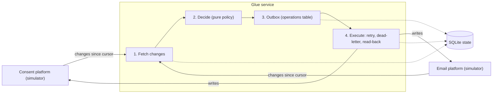

# Consent glue service

A small glue service that keeps marketing consent consistent between two systems that do not
integrate well: a **consent management platform** (the legal record of consent) and an
**email marketing platform** (where customers also unsubscribe).

Home assignment for the Forward Deployed Engineer role. **The two systems are simulators** written
for this exercise, with switchable failures. The glue service is the deliverable.
Customer context and value: [docs/customer-context.md](docs/customer-context.md).

Tested on: Python 3.14.4 on Ubuntu 26.04 (VM). Windows: to be confirmed.

## What it does

- Polls both systems for changes since a cursor and keeps a local snapshot per contact.
- Decides what each system must change, with one small pure function (`glue/policy.py`).
- Writes the decisions to an outbox table, then executes them with retries, a dead-letter list
  and a read-back check after every write.
- Handles conflicts, retries and partial failures, and records every decision in an audit log.

## Quick start

Requires Python 3.11 or newer.

Linux or macOS:

```
python3 -m venv .venv
source .venv/bin/activate
pip install -r requirements.txt
pytest -q
```

Windows (PowerShell):

```
python -m venv .venv
.venv\Scripts\Activate.ps1
pip install -r requirements.txt
pytest -q
```

If PowerShell blocks the activate script, run `Set-ExecutionPolicy -Scope CurrentUser RemoteSigned` once.

## Demo (three terminals, each with the virtual environment active)

Terminal 1: `uvicorn simulators.consent_platform:app --port 8001`
Terminal 2: `uvicorn simulators.email_platform:app --port 8002`
Terminal 3:

```
python -m glue run-once --dry-run      # shows what would happen, changes nothing
python -m glue run-once                # first sync
python -m glue run-once                # nothing to do: our own writes cause no echo
python -m glue status
curl -X POST http://127.0.0.1:8002/admin/simulate-unsubscribe/dave@example.com
python -m glue run-once                # the unsubscribe is recorded in the consent platform
curl http://127.0.0.1:8001/contacts/4
```

On Windows PowerShell use `curl.exe` instead of `curl`. Each simulator also has interactive API
docs at `/docs` (for example http://127.0.0.1:8002/docs), including the fault switches.

To start over: stop the simulators, delete `data/glue.db`, start the simulators again.

Seed data and what the first run does:

| Contact | Consent platform | Email platform | Result |
|---|---|---|---|
| alice, bob | opted in | subscribed | nothing |
| carol | withdrawn | subscribed | unsubscribed in email (R2) |
| dave | opted in | subscribed | nothing, used for the unsubscribe demo |
| erin | opted in | missing | created in email (R5) |
| frank | missing | subscribed | flagged for review, never changed automatically |

## Failure demos

Both were run against the simulators, with the demo above already done once. The fault switch is
`POST /admin/faults` on either simulator (modes `500`, `429`, `422`, `timeout`, `drop_response`).

**1. The email platform is down on the first sync** (start from an empty `data/glue.db`)

```
curl -X POST localhost:8002/admin/faults -H 'Content-Type: application/json' -d '{"mode":"500","remaining":1}'
python -m glue run-once    # status "partial", nothing planned
python -m glue run-once    # status "ok": carol and erin fixed, frank flagged for review
```

Planning is skipped until both systems were read once. A contact that was merely not seen yet is
therefore never created or resubscribed by mistake.

**2. The write succeeds but the response is lost**

```
curl -X POST localhost:8001/contacts/1/consent -H 'Content-Type: application/json' \
  -d '{"status":"withdrawn","effective_at":"2026-10-18T23:00:00Z","source":"preference_center"}'
curl -X POST localhost:8002/admin/faults -H 'Content-Type: application/json' \
  -d '{"mode":"drop_response","remaining":1,"hang_seconds":8}'
python -m glue run-once    # timeout after about 5 s, retry scheduled (attempt 1)
curl -X DELETE localhost:8002/admin/faults
curl localhost:8002/subscribers/alice@example.com    # already "unsubscribed": the write was applied
python -m glue run-once    # target already correct: nothing planned, the old operation is "superseded"
```

Result: no duplicate write and no lost update.

## Commands

| Command | Purpose |
|---|---|
| `python -m glue run-once [--dry-run] [--force]` | One sync pass. `--force` bypasses the mass-change guard. Exit code 2 if halted |
| `python -m glue status` | Operations by status, oldest pending, dead letters, review count, last run |
| `python -m glue dead-letters` | Failed operations with their reasons |
| `python -m glue replay [--op-id N]` | Requeue dead-lettered operations after the cause is fixed |

Settings: `GLUE_DB`, `GLUE_CONSENT_URL`, `GLUE_EMAIL_URL`, `GLUE_SALT` (environment variables or
CLI flags). Retry limits are constants in `glue/retry.py`.

## Architecture



One run:

1. **Fetch** changes from both systems (network, outside any database transaction). If one system
   fails, the other is still synced and the failing system's cursor does not advance.
2. **One transaction:** update the local snapshot, run the policy for each touched contact, write
   the operations to the outbox, advance the cursors. A crash cannot lose a detected change, and
   a re-run cannot duplicate it.
3. **Execute** the due operations, each one independently.

## Conflict policy

The consent platform is the authority, the email platform is a follower. Followers can only
withdraw consent, never grant it. Statuses are compared as states, not as events.

| Situation | Action | Rule |
|---|---|---|
| Consent platform says withdrawn, email says subscribed | Unsubscribe in email | R2 |
| Email unsubscribed, not older than the consent state | Record the withdrawal in the consent platform with the customer's original timestamp | R3 |
| Consent platform holds a newer opt-in than the email unsubscribe | Resubscribe in email (valid re-consent) | R4 |
| Opted-in contact missing in email | Create it | R5 |
| Same timestamp on both sides | Resolve to withdrawn (GDPR-safe) | R3 |
| Contact unknown to the consent platform | Never changed, listed for review | review |

The policy is a pure function of the contact's state in each system. It computes one canonical
state first and derives the action per system, so a third system needs a new client and one state
entry, not a rewrite of the rules.

## Reliability

| Situation | Behaviour |
|---|---|
| HTTP 429 | Retry after the server's `Retry-After`, at least |
| 5xx, 408, timeout, connection error | Exponential backoff with jitter, 5 attempts, then dead-letter |
| Other 4xx (for example 422) | No retry, dead-letter immediately |
| 404 on delete | Treated as already done |
| Write applied but the response lost | The call times out and a retry is scheduled. The next run reads the target, sees the state is already correct, plans nothing and marks the pending operation `superseded`. Writes set a state, so repeating one is harmless anyway (see failure demo 2) |
| Process killed mid-run | Outbox rows survive, execution resumes on the next run |
| 37 of 500 operations fail | The other 463 succeed, failures are listed with reasons |
| Our own write comes back as a change | Both sides already match, so nothing is planned (no echo loop) |
| Stale pending operation | Marked `superseded` when the current decision no longer includes it |
| Source returns far too many changes | Mass-change guard halts the run and rolls back (`--force` to override) |
| First sync while one system is down | Planning is skipped until both systems were read once, so "missing" is never guessed |

Delivery is at-least-once with idempotent writes. It is not exactly-once.
Retries are scheduled in the database (`next_attempt_at`), never slept in the process.

## Observability and support

- JSON log lines on stderr with `run_id`, `op_id`, `contact_key`, rule and outcome.
- **No email addresses in logs or audit rows**: only a salted hash (`contact_key`). The address is
  stored only in the `contacts` table, because the glue needs it to call the email platform.
- Tables for support: `operations` (status, attempts, last error), `audit_log` (which rule decided
  what, and when), `runs` (counts per run), `review_items`.
- `status` answers: how many pending, how old is the oldest, how many dead letters, when did the
  last run finish.

How I would troubleshoot: `status`, then `dead-letters` for reasons, then the audit log for one
`contact_key`, then replay once the cause is fixed.

## Tests

`pytest -q` runs 50 tests in well under a second, with no network:

| File | Covers |
|---|---|
| `tests/test_policy.py` | Every rule, ties, re-consent, convergence, a third system |
| `tests/test_db.py` | Idempotent outbox, cursor and operations commit together, pseudonymous key |
| `tests/test_clients.py` | Error classification, 404 handling, paging, no email in error messages |
| `tests/test_retry.py` | Backoff growth, cap, `Retry-After` as a minimum |
| `tests/test_executor.py` | Retry, dead-letter, replay, lost response, read-back mismatch, batch isolation |
| `tests/test_engine.py` | First sync, convergence, dry-run, mass-change guard, stale operations, no email outside `contacts` |
| `tests/test_cli.py` | Smoke tests |

The engine and executor tests use in-memory fake systems that behave like the simulators.

## Assumptions

- The consent platform is the legal record of consent and the only place that can grant it.
- Both systems can list records changed since a timestamp, and writes set a state (upsert).
- A contact is identified across systems by its normalized email (trimmed, lowercase).
- Timestamps are UTC. The effective time of a consent change is carried across systems.
- Volumes are modest (hundreds of thousands of contacts, few changes per run).

## Design decisions and trade-offs

| Decision | Why | What I would change in production |
|---|---|---|
| Polling with a cursor | Works with any API, simple to reason about | Webhooks feeding the same decide and outbox steps, polling as a fallback |
| Transactional outbox in SQLite | Detected changes are never lost, and the retry state survives restarts | Postgres, with `FOR UPDATE SKIP LOCKED` for several workers |
| Idempotency key includes the target's observed state | A target that drifts back to a state we fixed before gets fixed again | Same |
| Compare states, not events | No echo loop, and re-running is harmless | Same |
| Plain SQL, no ORM | Behaviour stays visible and easy to review | Same, or a query layer |
| Sequential execution | Easy to reason about | Parallel workers and bulk endpoints (the per-record API call is the expected bottleneck) |
| Simulators | Reviewers can run everything, and failures can be forced on demand | Real vendor clients behind the same interface (auth, paging style, field names change) |

## Known limitations and possible extensions

| Limitation | Fix in a sentence or two |
|---|---|
| **Erasure (GDPR right to erasure) is not implemented.** The consent simulator has the endpoints, the client methods and the `erasure_requests` table exist, but the engine does not process them | Create a delete operation per request, delete in email, read back, mark the request complete in the consent platform, then purge the contact's address from the local database |
| An operation whose write succeeded but whose response was lost ends as `superseded`, not `confirmed` | On supersede, if the target already matches the desired state, record it as confirmed by observation |
| No lock against overlapping runs | A lock row or file, idempotent operation keys already make an accidental overlap harmless |
| No metrics endpoint, and no load measurement | Expose counters from the run stats, and measure operations per second against the simulators with 10,000 contacts |
| Default salt for `contact_key` | Read it from a secret store |
| Polling cannot see deletions in a source system | Webhooks, or a periodic full comparison |
| The local `contacts` table holds email addresses | Encrypt at rest and apply a retention period |
| Retry-After HTTP-date form is not supported | Parse both forms |
| Email normalization is only trim and lowercase | Provider-aware normalization |
| Cursor is inclusive, so some records are re-read | Intended: duplicates are absorbed by the idempotency key |
| Mass-change guard thresholds are not CLI options | Move retry and guard settings into a config file |
| No authentication, simulators keep data in memory | OAuth client credentials in the real clients |

## Use of AI

I used Claude (Anthropic's AI assistant) in a chat, step by step, from scenario selection to code,
tests and documentation. The raw log of what I asked and what I changed is in
[docs/ai-usage-notes.md](docs/ai-usage-notes.md).

- **Where AI helped:** comparing scenarios, drafting the design, drafting the simulators, policy,
  database layer, clients, executor, engine, CLI, tests and this document. A design review found
  two flaws that I had fixed with tests: a duplicate key that hid repeated drift, and stale pending
  operations applied after a newer decision.
- **How I used it:** in small blocks. I ran each block and its tests before moving on.
- **What I verified myself:** I ran the failure behaviours by hand against the simulators (429 with
  Retry-After, 422 on naive timestamps, a lost response after a successful write) and compared them
  with the logs, instead of trusting generated tests alone. I also ran the end-to-end demo above.
- **Where I deliberately did not rely on AI:** the conflict rules and their GDPR reasoning (I reviewed
  them before accepting), the scope decisions (what is out), and the setup of the environment,
  Git and this repository. The simulators are my assumptions of typical SaaS behaviour and were not
  checked against any real vendor API.

## How this maps to Oracle integration patterns

| This project | Oracle Fusion Middleware / EBS equivalent |
|---|---|
| `operations` outbox with a status column | Open Interface tables with a process flag |
| Scheduled retries with backoff | SOA fault policy, retry on fault |
| Dead-letter list and `replay` | Error queue and recovery console |
| `run_id` on every log line and audit row | ECID, instance tracking |
| Idempotency key | Idempotent consumer pattern |
| `status` command and the tables | Enterprise Manager monitoring |

## Project layout

```
glue/          policy, db, clients, retry, executor, engine, cli
simulators/    consent_platform, email_platform, faults (failure injection)
tests/         50 tests
docs/          customer-context.md, ai-usage-notes.md
```
